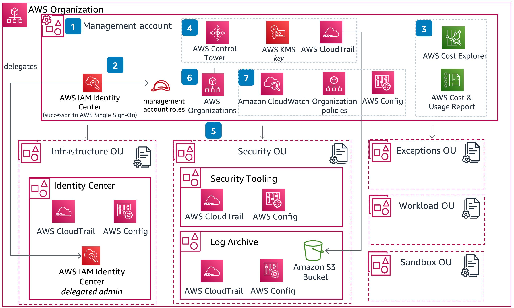

# AWS-Landing-Zone

## 1. Business Context & Objectives

### 1.1 Project Overview

This project designs and implements a secure, scalable and governed AWS Landing Zone for a hypothetical Netherlands-based banking institution operating within the European Union.

The landing zone provides a standardized AWS foundation for deploying and operating banking applications and supporting services across multiple AWS accounts and environments.

The architecture uses AWS Organizations, AWS Control Tower, centralized security services, shared networking and Infrastructure as Code to establish consistent governance and operational controls.

The project is designed as a practical cloud architecture and Terraform implementation portfolio.

### 1.2 Project Objectives

The primary objectives are to:

1. Establish a multi-account AWS environment with clear separation of responsibilities.
2. Implement centralized identity and access management.
3. Establish secure network connectivity and workload isolation.
4. Centralize security monitoring, audit logging and configuration management.
5. Implement encryption and secure secrets management.
6. Establish backup, recovery and resilience capabilities.
7. Automate infrastructure provisioning using Terraform.
8. Incorporate relevant EU financial-sector regulatory considerations into the architecture.

### 1.3 Scope

**In scope**

- AWS Organizations and account structure.
- AWS Control Tower governance foundation.
- Organizational Units and Service Control Policies.
- IAM Identity Center and federated access.
- Centralized network architecture using AWS Transit Gateway.
- Network inspection and workload segmentation.
- AWS CloudTrail and AWS Config.
- GuardDuty and Security Hub.
- KMS encryption and secrets management.
- Centralized backup and recovery architecture.
- Terraform-based infrastructure deployment.
- CI/CD automation and infrastructure validation.

**Out of scope**

- Building a complete banking application.
- Implementing a production payment-processing platform.
- Demonstrating full regulatory certification.
- Building a complete SWIFT or PCI DSS environment.
- Implementing every possible banking business-unit account.

PCI DSS and SWIFT-related architecture components will be considered only where relevant and will not be represented as certified implementations.

### 1.4 Regulatory Design Considerations

The architecture will consider the following frameworks where applicable:

| Framework | Architecture consideration |
|---|---|
| DORA | ICT risk management, operational resilience and incident response |
| GDPR | Personal-data protection, access control, encryption and data governance |
| EBA guidance | Relevant ICT and security expectations |
| PCI DSS | Segmentation and protection of cardholder-data environments, if applicable |
| SWIFT CSCF | Security architecture for SWIFT-connected environments, if applicable |

These considerations inform architectural decisions. This portfolio implementation does not constitute regulatory approval or certification.

### 1.5 Expected Outcomes

At the end of the project, the implementation should demonstrate:

- A documented AWS multi-account landing zone.
- Three professional architecture diagrams.
- A modular Terraform repository.
- Reusable infrastructure modules.
- Secure identity and access patterns.
- Centralized networking and security services.
- Automated deployment and validation.
- Evidence of successful infrastructure deployment and testing.

## 2. Architecture Principles

### 2.1 Security by Design

Security must be incorporated into every architectural layer rather than added after deployment.

**Design principles:**
- Apply least-privilege access across AWS accounts and services.
- Use centralized identity management through IAM Identity Center.
- Enforce multi-factor authentication for privileged access.
- Use encryption at rest and in transit.
- Store secrets in AWS Secrets Manager or an appropriate secure service.
- Apply preventive and detective security controls.
- Use AWS Organizations SCPs to establish account-level permission guardrails.

**AWS services:** IAM, IAM Identity Center, AWS Organizations, KMS, Secrets Manager, GuardDuty and Security Hub.

### 2.2 Multi-Account Governance

Separate AWS accounts according to security boundaries, operational responsibilities and workload environments.

**Design principles:**
- Use AWS Organizations to manage the AWS environment centrally.
- Use AWS Control Tower to establish the landing-zone governance foundation.
- Separate management, security, logging, networking and workload responsibilities.
- Isolate production from non-production environments.
- Apply consistent account baselines and organizational policies.
- Automate account provisioning where practical.

**AWS services:** AWS Organizations, AWS Control Tower, Account Factory and AWS Account Factory for Terraform (AFT).

### 2.3 Network Segmentation and Isolation

Network architecture must limit unnecessary connectivity between workloads and centralize traffic inspection.

**Design principles:**
- Adopt a hub-and-spoke network architecture.
- Use AWS Transit Gateway for inter-VPC connectivity.
- Centralize network inspection and controlled internet egress.
- Keep banking workloads in private subnets by default.
- Segment production and non-production networks.
- Restrict east-west traffic between workloads.
- Use VPC endpoints for supported AWS service connectivity.
- Use controlled VPN or Direct Connect connectivity where required.

**AWS services:** Amazon VPC, Transit Gateway, Network Firewall, Route 53 Resolver, VPC endpoints and AWS Site-to-Site VPN.

### 2.4 High Availability and Resilience

The landing zone should support reliable workloads and provide a foundation for recovery from infrastructure and regional failures.

**Design principles:**
- Deploy critical workloads across multiple Availability Zones.
- Avoid unnecessary single points of failure.
- Establish centralized backup and recovery capabilities.
- Define recovery time objectives (RTO) and recovery point objectives (RPO) for workloads.
- Support cross-account backups and cross-Region recovery where justified.
- Test backup restoration and recovery procedures.

**AWS services:** AWS Backup, Amazon S3, Multi-AZ architectures and AWS Elastic Disaster Recovery where appropriate.

### 2.5 Infrastructure as Code and Automation

Infrastructure must be consistently provisioned, version-controlled and reproducible.

**Design principles:**
- Use Terraform as the primary infrastructure provisioning tool.
- Develop reusable and modular Terraform configurations.
- Separate global infrastructure from environment-specific infrastructure.
- Store Terraform state securely in an encrypted remote backend.
- Use automated formatting, validation, planning and deployment.
- Use OIDC federation for CI/CD authentication instead of long-lived AWS access keys.
- Require additional approval for production changes.

**Tools and services:** Terraform, GitHub Actions, AWS IAM, Amazon S3 and Terraform state locking.

### 2.6 Centralized Monitoring and Auditability

Security events, infrastructure changes and operational activity must be centrally observable.

**Design principles:**
- Centralize AWS account activity logging.
- Enable organization-wide CloudTrail.
- Use AWS Config to monitor resource configuration and compliance with selected rules.
- Aggregate security findings centrally.
- Monitor network traffic and workload activity.
- Protect audit logs from unauthorized modification or deletion.
- Establish alerts for important security and operational events.

**AWS services:** AWS CloudTrail, AWS Config, GuardDuty, Security Hub, CloudWatch and VPC Flow Logs.

### 2.7 Data Protection and Privacy

Sensitive banking and customer data must receive appropriate protection throughout its lifecycle.

**Design principles:**
- Classify data according to sensitivity and business impact.
- Encrypt sensitive data at rest and in transit.
- Apply least-privilege access to data stores.
- Protect encryption keys using AWS KMS.
- Apply appropriate retention and deletion policies.
- Restrict access to sensitive logs and backups.
- Consider data residency and cross-border transfer requirements when selecting Regions and services.

**AWS services:** AWS KMS, Amazon S3, Amazon RDS, AWS Secrets Manager and Amazon Macie where appropriate.

### 2.8 Operational Efficiency and Cost Management

The landing zone should provide consistent operations while keeping infrastructure costs visible and controlled.

**Design principles:**
- Apply standardized resource tagging.
- Establish account and workload cost allocation.
- Monitor AWS spending and usage.
- Use automation to reduce manual operational tasks.
- Select appropriate resource sizes for each environment.
- Avoid deploying unnecessary services in the portfolio implementation.

**AWS services:** AWS Cost Explorer, AWS Budgets, AWS Organizations and AWS Compute Optimizer.

### 2.9 Regulatory Alignment

The architecture should incorporate relevant regulatory and industry expectations without treating technical deployment as proof of compliance.

**Design principles:**
- Consider DORA requirements for ICT risk management and operational resilience.
- Apply GDPR principles to personal-data protection and access.
- Consider relevant EBA guidance according to the institution's activities.
- Design separate PCI DSS or SWIFT environments only where applicable.
- Maintain evidence of infrastructure configuration, access and operational activity.

Regulatory applicability and implementation requirements must be confirmed against the institution's actual scope.

## 2.10 Summary

The landing zone will be designed around the following principles:

| Principle | Architectural outcome |
|---|---|
| Security by Design | Consistent preventive and detective controls |
| Multi-Account Governance | Clear account boundaries and centralized governance |
| Network Segmentation | Controlled connectivity and traffic inspection |
| Resilience | Multi-AZ deployment and tested recovery |
| Automation | Reproducible Terraform infrastructure |
| Centralized Monitoring | Organization-wide logging and security visibility |
| Data Protection | Encryption, access control and data governance |
| Cost Management | Visibility, tagging and controlled resource usage |
| Regulatory Alignment | Relevant regulatory considerations built into design decisions |

## 3. AWS Organization Design

### 3.1 Overview

The AWS Organization will provide centralized governance and management of multiple AWS accounts.

Each account will have a defined responsibility, reducing the impact of security incidents, limiting administrative access and supporting workload isolation.

The organization will use:
- AWS Organizations for centralized account management.
- AWS Control Tower for landing-zone governance.
- Organizational Units (OUs) for logical account grouping.
- Service Control Policies (SCPs) for organization-level permission guardrails.
- IAM Identity Center for centralized workforce access.
- AWS Account Factory for standardized account provisioning.

Terraform will manage the custom organization configuration and supporting infrastructure.

### 3.2 Organization Hierarchy

The proposed organization hierarchy is:



```text
AWS ORGANIZATION ROOT
│
├── MANAGEMENT ACCOUNT
│   └── Central organization management
│
├── SECURITY OU
│   ├── AUDIT / SECURITY ACCOUNT
│   └── LOG ARCHIVE ACCOUNT
│
├── INFRASTRUCTURE OU
│   ├── NETWORK ACCOUNT
│   ├── SHARED SERVICES ACCOUNT
│   └── DEVOPS / PLATFORM ACCOUNT
│
├── WORKLOADS OU
│   │
│   ├── PRODUCTION OU
│   │   └── PRODUCTION WORKLOAD ACCOUNT
│   │
│   └── NON-PRODUCTION OU
│       └── DEVELOPMENT WORKLOAD ACCOUNT
│
└── SANDBOX OU
    └── SANDBOX ACCOUNT
```

The hierarchy separates organization administration, security operations, shared infrastructure and application workloads.

### 3.3 AWS Account Structure

The portfolio implementation will use nine AWS accounts, including the Management Account.

| Account | Organizational Unit | Responsibility |
|---|---|---|
| Management | Organization Root | Organizations, Control Tower and billing |
| Audit / Security | Security | Security administration and audit access |
| Log Archive | Security | Centralized audit and configuration logs |
| Network | Infrastructure | Transit Gateway, inspection and connectivity |
| Shared Services | Infrastructure | Shared DNS and infrastructure services |
| DevOps / Platform | Infrastructure | Terraform automation and deployment tooling |
| Production Workload | Production | Production banking workloads |
| Development Workload | Non-Production | Development and testing workloads |
| Sandbox | Sandbox | Controlled experimentation |

#### 3.3.1 Management Account

The Management Account is the central administrative account for AWS Organizations.

Responsibilities:
- Manage the AWS Organization.
- Manage organization-level billing.
- Coordinate AWS Control Tower.
- Manage organization-wide account governance.
- Coordinate account provisioning.

Design restrictions:
- Do not deploy application workloads here.
- Restrict administrative access.
- Use dedicated roles for organization-level administration.
- Protect management credentials and privileged sessions.

#### 3.3.2 Audit / Security Account

This account provides centralized security administration and audit capabilities.

Responsibilities:
- Administer security monitoring services.
- Aggregate and investigate security findings.
- Provide controlled audit access.
- Support security incident investigation.

Potential services:
- AWS Security Hub.
- Amazon GuardDuty delegated administration.
- AWS Config aggregation.
- Amazon Inspector administration.

#### 3.3.3 Log Archive Account

This account provides centralized storage for AWS audit and operational logs.

Responsibilities:
- Store organization-wide CloudTrail logs.
- Store AWS Config delivery data.
- Provide controlled log access.
- Protect audit records from unauthorized modification or deletion.

Potential services:
- Amazon S3.
- AWS CloudTrail.
- AWS Config.
- AWS KMS.

#### 3.3.4 Network Account

This account hosts centralized network infrastructure.

Responsibilities:
- Manage Transit Gateway.
- Host centralized network inspection.
- Manage shared network connectivity.
- Provide controlled ingress and egress.
- Manage network segmentation.

Potential services:
- Amazon VPC.
- AWS Transit Gateway.
- AWS Network Firewall.
- Route 53 Resolver.
- AWS Site-to-Site VPN.

#### 3.3.5 Shared Services Account

This account hosts infrastructure shared by multiple workload accounts.

Responsibilities:
- Shared DNS services.
- Internal service discovery.
- Shared infrastructure components.
- Common platform services where appropriate.

Potential services:
- Amazon Route 53.
- Route 53 Resolver endpoints.
- Amazon S3.
- AWS Systems Manager.

#### 3.3.6 DevOps / Platform Account

This account provides the infrastructure automation and deployment platform.

Responsibilities:
- Run Terraform deployment pipelines.
- Manage deployment automation.
- Coordinate infrastructure releases.
- Store approved deployment artifacts.
- Provide platform engineering capabilities.

Potential services:
- GitHub Actions OIDC integration.
- Amazon S3 for Terraform state, where appropriate.
- Amazon ECR.
- AWS IAM deployment roles.
- AWS Systems Manager.

#### 3.3.7 Production Workload Account

This account hosts production banking applications and their supporting infrastructure.

Responsibilities:
- Host production application workloads.
- Access approved shared services.
- Use production-specific security controls.
- Send logs and security findings to centralized accounts.
- Use controlled backup and recovery processes.

Production resources must be isolated from development and sandbox environments.

#### 3.3.8 Development Workload Account

This account hosts development and testing infrastructure.

Responsibilities:
- Support application development.
- Run integration and testing environments.
- Validate infrastructure changes.
- Support application deployment testing.

Development workloads must not have unrestricted access to production resources or data.

#### 3.3.9 Sandbox Account

This account provides an isolated environment for experimentation.

Responsibilities:
- Test new AWS services.
- Validate technical concepts.
- Experiment with Terraform modules.
- Support learning and demonstrations.

The account will have spending limits and restrictive security guardrails.

### 3.4 Organizational Units

Organizational Units group accounts according to their purpose and security requirements.

| OU | Purpose | Governance approach |
|---|---|---|
| Security | Central security and audit accounts | Strong protection and restricted administration |
| Infrastructure | Shared network and platform services | Controlled infrastructure administration |
| Workloads | Banking application environments | Workload-specific controls |
| Production | Critical production workloads | Strongest operational restrictions |
| Non-Production | Development and testing | Controlled development access |
| Sandbox | Experimental workloads | Restricted services and spending controls |

Production and Non-Production are nested under the Workloads OU.

The Management Account remains outside these workload OUs.

### 3.5 Service Control Policies

Service Control Policies will establish permission guardrails across the organization.

Proposed guardrails include:

| SCP control | Objective |
|---|---|
| Restrict unapproved Regions | Limit resource deployment to approved AWS Regions |
| Protect security services | Restrict disabling selected security controls |
| Protect audit logging | Restrict unauthorized modification of logging configuration |
| Protect organization management | Restrict unauthorized organization-level changes |
| Restrict public exposure | Limit selected public resource configurations |
| Restrict leaving the organization | Prevent unauthorized account removal |

SCPs define the maximum available permissions; they do not grant permissions themselves.

The policies must be tested against legitimate AWS service operations and Control Tower requirements before enforcement.

### 3.6 Identity and Access Management

IAM Identity Center will provide centralized workforce access.

The proposed access model is:

```text
Corporate Identity Provider
          │
          ▼
   IAM Identity Center
          │
          ▼
   Permission Sets
          │
          ▼
     AWS Accounts
          │
          ▼
   Temporary IAM Roles
```

Design principles:
- Federated workforce authentication.
- MFA for privileged access.
- Least-privilege permission sets.
- Separate administrative and operational permissions.
- Temporary credentials instead of long-lived access keys.
- Auditable privileged access.

### 3.7 Account Provisioning and Governance

AWS Control Tower Account Factory will provide standardized account provisioning.

AWS Account Factory for Terraform (AFT) can be introduced to automate account requests and account customization through Terraform and Git-based workflows.

The intended provisioning process is:

```text
Account Request
      │
      ▼
Approved Account Configuration
      │
      ▼
Account Factory / AFT
      │
      ▼
AWS Account Creation
      │
      ▼
OU Assignment
      │
      ▼
Baseline Governance
      │
      ▼
Account Ready for Workloads
```

For this portfolio, account provisioning should be automated where practical without introducing unnecessary platform complexity.

### 3.8 Regional Strategy

The initial architecture will use a primary AWS Region in the EU.

A secondary EU Region may be used for disaster recovery, depending on service availability, workload recovery requirements and data-transfer considerations.

Region restrictions will be implemented through organization guardrails, with appropriate exceptions for globally operated AWS services and required control-plane operations.

The final Region selection will be confirmed during network and resilience design.

### 3.9 Implementation Scope

The architecture distinguishes between the full reference design and the resources actually deployed for the portfolio.

**Initial deployment targets:**
- AWS Organization and account structure.
- Security and infrastructure OUs.
- Development and production workload separation.
- Organization-level governance controls.
- Centralized logging and security foundations.

**Potential later additions:**
- AFT-based account provisioning.
- Dedicated backup account.
- Separate PCI DSS or SWIFT environments.
- Additional business-unit workload accounts.
- Secondary-region disaster recovery.

## 4. Network & Security Architecture

### 4.1 Network Architecture Overview

The AWS banking landing zone will adopt a centralized hub-and-spoke network architecture.

The Network Account will host shared networking and traffic inspection components, while individual workload accounts will maintain separate VPCs for their respective environments.

AWS Transit Gateway will provide controlled connectivity between approved VPCs.

The architecture will enforce network segmentation, centralized traffic inspection and restricted communication between workload environments.

#### Architectural components

| Component | Responsibility |
|---|---|
| AWS Transit Gateway | Central connectivity between approved VPCs |
| Network Account | Hosts shared network infrastructure |
| Inspection VPC | Centralized network traffic inspection |
| AWS Network Firewall | Network traffic filtering and inspection |
| NAT Gateway | Controlled outbound internet connectivity |
| Route 53 Resolver | DNS resolution across connected networks |
| VPC IPAM | IP address allocation and management |
| VPN / Direct Connect | Optional hybrid connectivity |

The network architecture will prioritize private connectivity and minimize unnecessary public exposure.

### 4.2 AWS Account Network Structure

Each account will have a clearly defined networking responsibility.

| AWS Account | Network responsibility |
|---|---|
| Network | Transit Gateway, Inspection VPC and centralized connectivity |
| Shared Services | Shared DNS and internal infrastructure |
| Production | Production workload VPC |
| Development | Development and testing VPC |
| Sandbox | Isolated experimental VPC, where required |

The Security, Log Archive and DevOps accounts will consume approved network services where necessary.

### 4.3 Hub-and-Spoke Network Design

The Network Account will act as the central networking hub.

Workload and shared-service VPCs will connect to the Transit Gateway through cross-account attachments.

The proposed topology is:

```text
                  NETWORK ACCOUNT
                         |
                 AWS TRANSIT GATEWAY
                         |
          +--------------+--------------+
          |              |              |
          |              |              |
     PRODUCTION      DEVELOPMENT    SHARED SERVICES
        VPC              VPC             VPC
          |              |              |
     Production       Development      Internal
     Applications     Applications     Services
```

The Inspection VPC will be connected to the Transit Gateway and used for traffic that requires centralized inspection.

Transit Gateway route tables will determine which VPCs can communicate and which traffic must pass through inspection.

### 4.4 VPC Architecture and IP Addressing

Each workload environment will have its own VPC and independent IP address range.

Proposed CIDR allocation:

| VPC | CIDR | Purpose |
|---|---|---|
| Production | 10.10.0.0/16 | Production banking applications |
| Development | 10.20.0.0/16 | Development and testing |
| Network | 10.30.0.0/16 | Inspection and network services |
| Shared Services | 10.40.0.0/16 | Shared infrastructure |

Each VPC will use multiple Availability Zones where supported.

Subnet design:

- Public subnets: Only for components that explicitly require public connectivity.
- Private application subnets: Host application workloads.
- Private data subnets: Host databases and sensitive data services.
- Inspection subnets: Host network inspection components where applicable.

IP ranges must be validated against existing corporate networks before deployment.

### 4.5 Network Segmentation and Traffic Control

Network segmentation will prevent unrestricted communication between banking environments.

The following boundaries will be implemented:

| Segment | Connectivity requirement |
|---|---|
| Production | Access only approved production and shared services |
| Development | Access development and explicitly approved shared services |
| Shared Services | Accept connections from authorized accounts |
| Inspection | Inspect traffic selected by routing policies |
| Sandbox | Isolated from production by default |

Security groups will enforce workload-level traffic restrictions.

Network ACLs will provide additional subnet-level controls where justified.

Transit Gateway route tables will provide routing isolation between environments.

Production-to-development connectivity will be denied by default unless an explicitly approved use case requires it.

### 4.6 Centralized Network Inspection

The Inspection VPC will provide centralized traffic inspection.

AWS Network Firewall will be used to filter traffic according to approved network security policies.

Inspection will be applied to selected traffic flows, including:

- Outbound internet traffic.
- Inter-VPC traffic requiring inspection.
- Hybrid network traffic where applicable.

The architecture will use appropriate Transit Gateway routing and firewall endpoint routing to prevent unintended inspection bypass.

The inspection design must account for Availability Zone alignment, routing symmetry and firewall availability.

### 4.7 Internet Ingress and Egress

Internet connectivity will be controlled and minimized.

#### Inbound connectivity

```text
             INTERNET
                |
                v
          AWS WAF (optional)
                |
                v
        Application Load Balancer
                |
                v
       Private Application Subnets
```

AWS WAF will provide web application protection where public-facing applications require it.

Application Load Balancers will distribute traffic to private application workloads.

Internal banking applications will not be exposed publicly unless explicitly required.

#### Outbound connectivity

```text
       PRIVATE WORKLOAD
              |
              v
       TRANSIT GATEWAY
              |
              v
        INSPECTION VPC
              |
              v
     AWS NETWORK FIREWALL
              |
              v
          NAT GATEWAY
              |
              v
           INTERNET
```

Outbound access will be restricted through firewall policies and routing controls.

### 4.8 AWS Service Connectivity

VPC endpoints will provide private connectivity to supported AWS services.

Proposed endpoints include:

| Endpoint | Purpose |
|---|---|
| S3 Gateway | Private Amazon S3 access |
| ECR API | Container registry API access |
| ECR Docker | Container image retrieval |
| CloudWatch Logs | Private log delivery |
| STS | AWS Security Token Service |
| Secrets Manager | Secure secret retrieval |

Endpoint policies and security groups will restrict access to approved resources.

### 4.9 Hybrid Connectivity

The architecture will support future integration with corporate networks and external banking infrastructure.

Connectivity options:

- AWS Site-to-Site VPN.
- AWS Direct Connect.
- Transit Gateway integration.

Site-to-Site VPN will be the preferred demonstration option if external connectivity is required.

Direct Connect will remain an optional architecture component rather than a mandatory portfolio deployment.

### 4.10 Identity and Access Security

IAM Identity Center will provide centralized workforce access across AWS accounts.

The access model will use corporate identity federation, permission sets and temporary credentials.

```text
       CORPORATE IDENTITY PROVIDER
                  |
                  v
         IAM IDENTITY CENTER
                  |
                  v
             PERMISSION SETS
                  |
                  v
              AWS ACCOUNTS
                  |
                  v
          TEMPORARY IAM ROLES
```

Security principles:

- Centralized authentication.
- MFA for privileged users.
- Least-privilege permission sets.
- Separation of administrative and operational access.
- Temporary credentials.
- Auditable privileged sessions.
- Controlled break-glass access.

### 4.11 Terraform and GitHub Actions Security Architecture

Terraform will be the primary infrastructure provisioning tool.

GitHub Actions will automate Terraform validation, planning and deployment.

GitHub OIDC federation will provide secure authentication between GitHub Actions and AWS without requiring long-lived AWS access keys.

#### Deployment architecture

```text
             GITHUB REPOSITORY
                    |
                    v
             GITHUB ACTIONS
                    |
        +-----------+-----------+
        |           |           |
        v           v           v
      FMT       VALIDATE     SECURITY SCAN
        |           |           |
        +-----------+-----------+
                    |
                    v
             TERRAFORM PLAN
                    |
                    v
              GITHUB OIDC
                    |
                    v
               AWS IAM ROLE
                    |
                    v
             TERRAFORM APPLY
                    |
                    v
               AWS ACCOUNTS
```

#### Deployment security principles

- Use GitHub OIDC for AWS authentication.
- Restrict OIDC trust policies to the approved repository and deployment context.
- Use separate deployment roles for development and production.
- Separate Terraform plan and apply permissions.
- Protect production deployments using GitHub Environment approvals.
- Store Terraform state remotely in encrypted Amazon S3.
- Enable S3 native state locking.
- Restrict access to Terraform state and sensitive outputs.
- Run Terraform formatting, validation and security checks before deployment.

#### CI/CD workflow stages

| Workflow stage | Responsibility |
|---|---|
| Pull request | Validate proposed infrastructure changes |
| Terraform format | Check formatting |
| Terraform validate | Validate configuration |
| Security scanning | Check Terraform configurations |
| Terraform plan | Preview infrastructure changes |
| Development deployment | Apply approved changes |
| Production deployment | Apply changes after approval |
| Drift detection | Periodically identify configuration drift |

GitHub Actions will manage the deployment lifecycle. AWS CodePipeline and AWS CodeBuild are not part of this architecture.

### 4.12 Encryption and Secrets Management

Encryption will protect sensitive information at rest and in transit.

| AWS service / technology | Responsibility |
|---|---|
| AWS KMS | Encryption key management |
| AWS Secrets Manager | Application secrets |
| Amazon S3 | Encrypted object and log storage |
| Amazon RDS | Database encryption |
| AWS Certificate Manager | TLS certificates |
| TLS | Data encryption in transit |

Encryption keys will have controlled administrative and usage permissions.

Secrets will not be committed to GitHub repositories or embedded in Terraform source code.

### 4.13 Centralized Security Monitoring

The Security Account will provide centralized security administration.

The Log Archive Account will provide centralized storage for audit and configuration logs.

| Service | Responsibility |
|---|---|
| AWS CloudTrail | AWS API activity logging |
| AWS Config | Resource configuration monitoring |
| Amazon GuardDuty | Threat detection |
| AWS Security Hub | Security findings aggregation |
| Amazon Inspector | Vulnerability management for supported workloads |
| Amazon Macie | Sensitive data discovery in S3 |
| Amazon CloudWatch | Metrics, logs and alarms |
| VPC Flow Logs | Network traffic metadata |

Security monitoring will be enabled across relevant organization accounts.

CloudTrail organization trails and AWS Config aggregation will support centralized visibility.

### 4.14 Backup and Disaster Recovery

The architecture will provide a foundation for centralized backup and recovery.

Design principles:

- Use AWS Backup for supported resources.
- Separate backup administration from workload administration where practical.
- Support cross-account backup copies.
- Consider cross-Region backups for critical workloads.
- Apply appropriate retention policies.
- Protect critical backup vaults.
- Test restoration and recovery procedures.

Workload-specific RTO and RPO requirements will determine the final recovery design.

### 4.15 Regional Architecture

The initial deployment will use an EU AWS Region.

A secondary EU Region may be introduced for disaster recovery.

Regional design decisions will consider:

- AWS service availability.
- Data protection and transfer requirements.
- Workload latency.
- Recovery objectives.
- Operational complexity and cost.

The secondary Region will only be included in the implementation where justified by the portfolio scope and available budget.

### 4.16 Network and Security Architecture Summary

| Architecture area | Selected approach |
|---|---|
| Network topology | Hub-and-spoke |
| Central connectivity | AWS Transit Gateway |
| Network inspection | AWS Network Firewall |
| Workload isolation | Separate VPCs and accounts |
| Internet access | Controlled ingress and egress |
| AWS connectivity | VPC endpoints |
| Hybrid connectivity | VPN / optional Direct Connect |
| Workforce identity | IAM Identity Center |
| Infrastructure deployment | Terraform |
| CI/CD | GitHub Actions |
| AWS authentication | GitHub OIDC |
| Encryption | AWS KMS |
| Secrets | AWS Secrets Manager |
| Security monitoring | GuardDuty and Security Hub |
| Audit logging | CloudTrail and AWS Config |
| Backup | AWS Backup |

## 5. Architecture Decisions

### 5.1 Purpose

This section records the major technical decisions guiding the design and implementation of the AWS Banking Landing Zone.

The decisions establish a consistent architecture across AWS Organizations, networking, security, infrastructure automation and workload deployment.

Each decision documents:
- The selected technology or architectural approach.
- The reason for selecting it.
- Alternatives considered.
- The implications for implementation.

### 5.2 ADR-001: AWS Multi-Account Architecture

**Decision:** Use AWS Organizations with a multi-account structure.

**Rationale:**
- Separate security, infrastructure and workload responsibilities.
- Reduce the impact of security incidents.
- Establish independent account-level security boundaries.
- Support centralized billing and governance.
- Enable environment isolation.

**Alternatives considered:**
- Single AWS account.
- Multiple accounts without centralized organization management.

**Consequences:**
- AWS Organizations will manage the accounts.
- Organizational Units will group accounts by responsibility.
- SCPs will establish organization-level permission guardrails.
- Terraform will manage the custom organization configuration.

### 5.3 ADR-002: AWS Control Tower for Landing Zone Governance

**Decision:** Use AWS Control Tower as the landing-zone governance foundation.

**Rationale:**
- Establish a standardized multi-account landing zone.
- Provide centralized governance capabilities.
- Support account provisioning through Account Factory.
- Enable integration with AWS Organizations and IAM Identity Center.
- Reduce the amount of custom governance infrastructure required.

**Alternatives considered:**
- Building the entire landing zone manually using AWS Organizations.
- Using a fully custom Terraform-based organization framework.

**Consequences:**
- Control Tower will establish the foundational governance environment.
- Custom Terraform configurations will extend the landing zone.
- Control Tower-managed resources must not be independently managed by Terraform in conflicting ways.
- Account provisioning and governance changes must respect Control Tower's management boundaries.

AWS Account Factory for Terraform (AFT) may be introduced later if automated account vending becomes necessary. It is not a prerequisite for the initial portfolio implementation.

### 5.4 ADR-003: Centralized Security and Logging Accounts

**Decision:** Use separate Security and Log Archive accounts.

**Rationale:**
- Isolate security administration from application workloads.
- Centralize security findings.
- Protect audit records.
- Improve investigation and audit capabilities.
- Reduce the risk of workload administrators modifying centralized audit data.

**Alternatives considered:**
- Storing all security and audit information in the Management Account.
- Maintaining separate security and logging services in every workload account.

**Consequences:**
- The Security Account will provide centralized security administration.
- The Log Archive Account will store organization-wide audit logs.
- CloudTrail and AWS Config will provide centralized visibility.
- Cross-account permissions will control access to security and logging resources.

### 5.5 ADR-004: Hub-and-Spoke Network Architecture

**Decision:** Use AWS Transit Gateway with a centralized network hub.

**Rationale:**
- Simplify connectivity between multiple AWS accounts.
- Centralize network administration.
- Support workload network segmentation.
- Provide a foundation for centralized inspection.
- Support future hybrid connectivity.

**Alternatives considered:**
- Independent VPCs without centralized connectivity.
- VPC peering between individual workload accounts.

**Consequences:**
- The Network Account will host the Transit Gateway.
- Workload VPCs will connect through cross-account Transit Gateway attachments.
- Separate Transit Gateway route tables will enforce network segmentation.
- Network Firewall will inspect selected traffic flows.
- Routing and firewall rules must be carefully designed to prevent unintended access and inspection bypass.

### 5.6 ADR-005: Private Workload Networking

**Decision:** Deploy banking application workloads primarily in private subnets.

**Rationale:**
- Minimize direct internet exposure.
- Reduce attack surface.
- Restrict access to sensitive workloads.
- Support controlled outbound connectivity.

**Alternatives considered:**
- Deploying application workloads directly into public subnets.
- Using independent internet gateways and NAT infrastructure for every workload without centralized egress controls.

**Consequences:**
- Private subnets will host application and database workloads.
- Public subnets will only be used where explicitly required.
- Controlled egress will use approved network paths.
- VPC endpoints will provide private access to supported AWS services.

### 5.7 ADR-006: Centralized Identity Management

**Decision:** Use AWS IAM Identity Center with federated workforce authentication.

**Rationale:**
- Centralize workforce access across AWS accounts.
- Support MFA and permission sets.
- Reduce the need for individual IAM users.
- Improve access administration and auditing.
- Enable temporary role-based credentials.

**Alternatives considered:**
- Individual IAM users in every AWS account.
- Independently managed access credentials in each account.

**Consequences:**
- IAM Identity Center will manage workforce access.
- Permission sets will define account access.
- Privileged access will be restricted.
- Break-glass access will be controlled and monitored.

### 5.8 ADR-007: Terraform for Infrastructure as Code

**Decision:** Use Terraform as the primary infrastructure provisioning tool.

**Rationale:**
- Support reusable infrastructure modules.
- Maintain infrastructure definitions in version control.
- Enable repeatable deployments.
- Support multiple AWS accounts and environments.
- Integrate directly with GitHub Actions.
- Provide infrastructure change plans before deployment.

**Alternatives considered:**
- AWS CloudFormation.
- AWS CDK.
- Manual infrastructure provisioning through the AWS Console.

**Consequences:**
- Infrastructure will be organized into reusable Terraform modules.
- Environment-specific configurations will be maintained separately.
- Terraform formatting, validation and planning will be automated.
- Remote state will be used.
- Infrastructure changes will be reviewed through GitHub pull requests.

### 5.9 ADR-008: GitHub Actions for CI/CD

**Decision:** Use GitHub Actions as the CI/CD automation platform.

**Rationale:**
- Integrate infrastructure automation with the GitHub repository.
- Automate Terraform validation and deployment.
- Support pull-request-based infrastructure reviews.
- Provide environment-specific deployment workflows.
- Integrate approval controls for production deployments.

**Alternatives considered:**
- AWS CodePipeline and AWS CodeBuild.
- Jenkins.
- GitLab CI/CD.

**Consequences:**
- GitHub Actions will execute Terraform workflows.
- Separate workflows will support validation, planning and deployment.
- GitHub Environments will provide deployment protection and approvals.
- Production deployments will require additional authorization.
- AWS CodePipeline and AWS CodeBuild will not be used.

### 5.10 ADR-009: GitHub OIDC for AWS Authentication

**Decision:** Use GitHub OpenID Connect (OIDC) federation to authenticate GitHub Actions with AWS.

**Rationale:**
- Eliminate long-lived AWS access keys in GitHub.
- Use temporary AWS credentials.
- Restrict deployment access through IAM trust policies.
- Support separate permissions for different environments.
- Improve CI/CD security.

**Alternatives considered:**
- Storing AWS access keys in GitHub Secrets.
- Using a self-hosted deployment runner with separately managed credentials.

**Consequences:**
- AWS IAM will establish an OIDC identity provider for GitHub Actions.
- IAM trust policies will restrict access to the intended repository and deployment context.
- Separate IAM roles will be created for development and production deployments.
- Terraform plan and apply permissions will be separated where practical.
- Production deployment will require GitHub Environment approval.

### 5.11 ADR-010: Amazon S3 for Terraform Remote State

**Decision:** Use Amazon S3 as the Terraform remote state backend with native S3 state locking.

**Rationale:**
- Store state centrally.
- Support infrastructure deployment across environments.
- Provide durable and controlled state storage.
- Enable collaboration between authorized deployment processes.
- Support encryption and access restrictions.

**Alternatives considered:**
- Local Terraform state files.
- Terraform Cloud remote state.
- Other supported remote backend solutions.

**Consequences:**
- Terraform state will be stored in encrypted S3 buckets.
- State access will be restricted to authorized deployment roles.
- Native S3 lockfile support will prevent concurrent state operations.
- State recovery and versioning will be considered.
- State files and sensitive outputs must not be exposed in public repositories or workflow logs.

### 5.12 ADR-011: AWS KMS for Encryption

**Decision:** Use AWS KMS customer-managed keys where additional control over encryption keys is required.

**Rationale:**
- Control encryption key policies.
- Separate key administration from resource administration.
- Support encryption of sensitive infrastructure data.
- Improve auditability of key usage.
- Support applicable data protection requirements.

**Alternatives considered:**
- AWS-managed encryption keys.
- Application-managed encryption.

**Consequences:**
- KMS keys will be provisioned for selected services.
- Key policies will restrict administration and usage.
- Key rotation and deletion protections will be configured appropriately.
- Key deployment and cross-account usage will be planned carefully.

### 5.13 ADR-012: Centralized Security Monitoring

**Decision:** Use AWS-native security services with centralized administration.

**Selected services:**
- Amazon GuardDuty.
- AWS Security Hub.
- AWS Config.
- AWS CloudTrail.
- Amazon Inspector.
- Amazon Macie where appropriate.

**Rationale:**
- Provide visibility across AWS accounts.
- Detect suspicious activity.
- Monitor resource configuration.
- Identify security vulnerabilities.
- Support security investigations.

**Alternatives considered:**
- Individual security monitoring in every account.
- External security monitoring platforms as the primary security layer.

**Consequences:**
- Security services will be enabled according to workload requirements.
- Centralized administration will be configured in the Security Account.
- Findings will be aggregated centrally.
- Audit records will be delivered to the Log Archive Account.

### 5.14 ADR-013: AWS Backup for Data Protection

**Decision:** Use AWS Backup as the primary backup-management service for supported AWS resources.

**Rationale:**
- Centralize backup policies.
- Support cross-account backup copies.
- Enable recovery across accounts.
- Improve backup administration and visibility.
- Support workload recovery requirements.

**Alternatives considered:**
- Resource-specific backup scripts.
- Independently managed backup policies in each workload account.

**Consequences:**
- Backup policies will be defined according to workload criticality.
- Cross-account backup will be implemented where appropriate.
- Cross-Region copies will be considered for critical workloads.
- Restore procedures will be tested.

### 5.15 ADR-014: EU Regional Strategy

**Decision:** Use an EU AWS Region as the primary deployment Region, with a secondary EU Region considered for disaster recovery.

**Rationale:**
- Align the architecture with the institution's European operating context.
- Support regional resilience planning.
- Consider data protection and transfer requirements.
- Provide flexibility for recovery architecture.

**Alternatives considered:**
- Single-region deployment without a recovery strategy.
- Multi-region deployment for all workloads from the beginning.

**Consequences:**
- The primary Region will be confirmed before deployment.
- A secondary Region will only be introduced where justified.
- Regional service availability and recovery costs will be assessed.
- Data residency and transfer obligations will be evaluated according to the relevant data and service.

### 5.16 ADR-015: Environment Isolation

**Decision:** Separate production and non-production workloads into different AWS accounts.

**Rationale:**
- Reduce the impact of development mistakes.
- Protect production resources.
- Apply environment-specific access controls.
- Support independent infrastructure deployment.
- Improve cost allocation and operational management.

**Alternatives considered:**
- Hosting development and production workloads in one AWS account.
- Using only VPC separation within a shared account.

**Consequences:**
- Production and development will have separate AWS accounts.
- Terraform configurations will use environment-specific settings.
- Deployment roles will be separated.
- Production changes will require stronger approval controls.

### 5.17 Summary of Architecture Decisions

| ADR | Decision | Selected technology / approach |
|---|---|---|
| ADR-001 | Account architecture | AWS Organizations |
| ADR-002 | Landing-zone governance | AWS Control Tower |
| ADR-003 | Security and logging | Dedicated accounts |
| ADR-004 | Network connectivity | Transit Gateway hub-and-spoke |
| ADR-005 | Workload networking | Private subnets |
| ADR-006 | Workforce identity | IAM Identity Center |
| ADR-007 | Infrastructure as Code | Terraform |
| ADR-008 | CI/CD | GitHub Actions |
| ADR-009 | CI/CD authentication | GitHub OIDC |
| ADR-010 | Terraform state | Amazon S3 with native locking |
| ADR-011 | Encryption | AWS KMS |
| ADR-012 | Security monitoring | AWS-native security services |
| ADR-013 | Backup | AWS Backup |
| ADR-014 | Regional strategy | EU primary and optional EU recovery Region |
| ADR-015 | Environment isolation | Separate AWS accounts |
