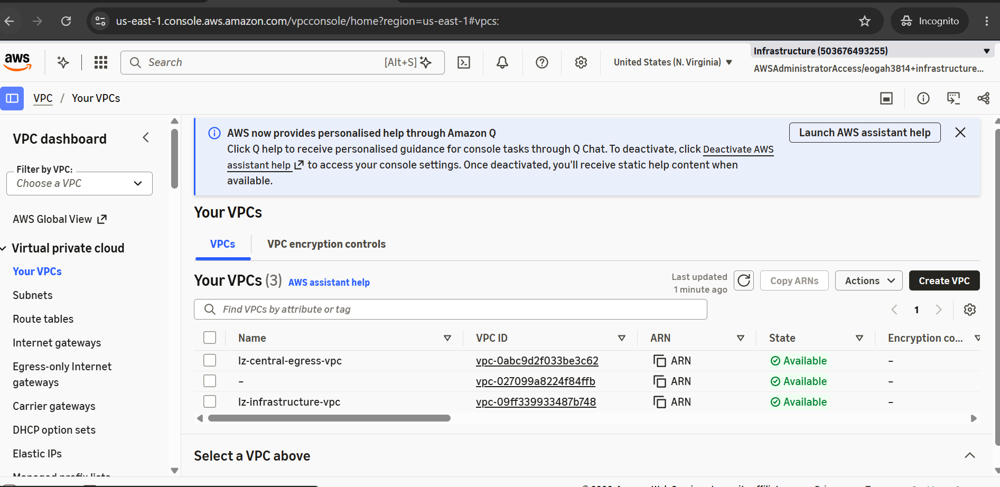
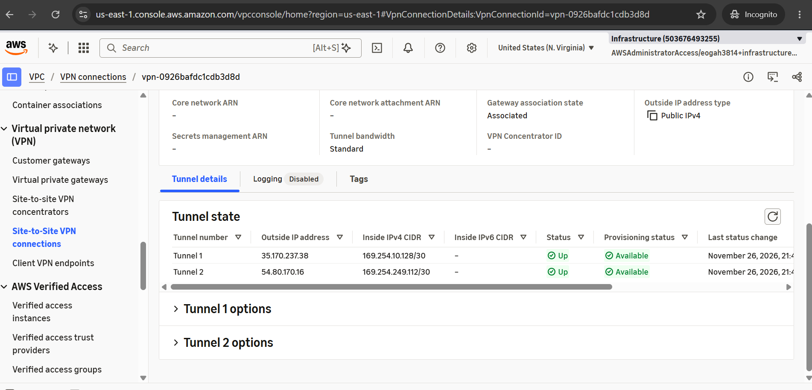
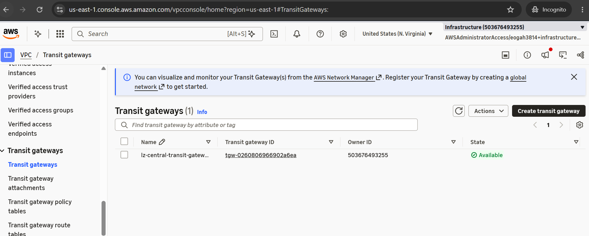
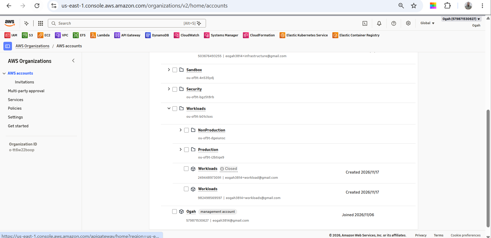
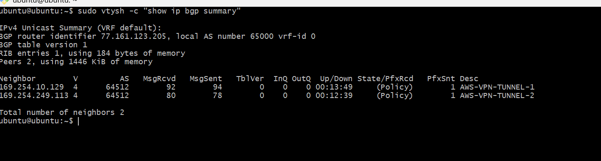
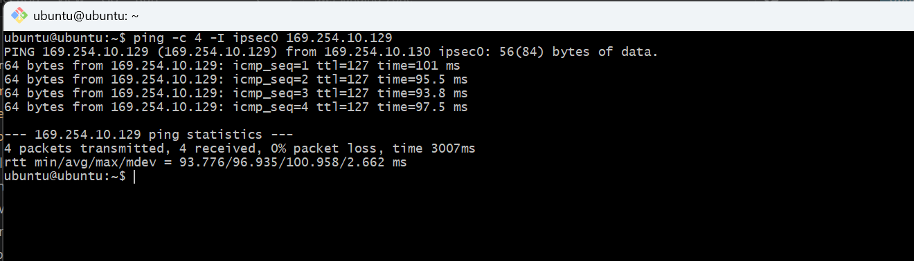

# AWS Landing Zone with Hybrid Network Connectivity

## Overview
This is a hybrid network connectivity project built with Terraform for an AWS landing zone.

On AWS, I used a Transit Gateway as the central hub for the Infrastructure, Production, and NonProduction VPCs. Terraform provisions the Customer Gateway and a Site-to-Site VPN with two IPsec tunnels. For dynamic routing, strongSwan terminates the tunnels on Ubuntu, and FRRouting exchanges routes with AWS using BGP. This lets the on-premises and AWS networks learn the routes they need without maintaining every route manually.

I also integrated the VPN with the centralized Network Firewall. Transit Gateway route tables steer traffic through the inspection VPC, and the return path follows the same inspection route. Firewall rules and security groups allow the required ICMP traffic while leaving other traffic subject to the existing policy.

On the Ubuntu side, the tunnel interfaces, IPsec settings, BGP peers, and network forwarding were configured to match the AWS tunnel parameters. The setup includes two tunnels for resilience, and BGP uses separate autonomous system numbers for the on-premises router and AWS.

Finally, I verified that both ends exchanged routes and that a device on-premises could reach a private AWS host. This project demonstrates infrastructure as code, hybrid networking, IPsec, BGP, network segmentation, and centralized traffic inspection.

## Aim
The goal was to connect an on-premises Ubuntu network securely to multiple AWS environments, while keeping traffic routed and inspected rather than opening direct, uncontrolled paths.

## Prerequsite

Before starting this project, ensure you have the following:

- **AWS Account**: An active AWS account with sufficient IAM permissions to provision VPCs, Transit Gateways, Site-to-Site VPNs, Customer Gateways, and AWS Network Firewall resources.
- **GitHub Repository**: A GitHub account to clone the project repository and manage the Terraform configuration.
- **Terraform**: Terraform CLI installed on your local workstation.
- **AWS CLI**: AWS Command Line Interface installed and configured with credentials to access your AWS account.
- **Ubuntu Virtual Machine**: At least one Ubuntu VM running in a virtualization environment (e.g., VirtualBox, VMware, or Hyper-V) to simulate an on-premises corporate network and act as the VPN endpoint.
- **Networking Knowledge**: Basic understanding of TCP/IP, subnetting, routing, IPsec VPNs, and BGP.
- **Linux Administration**: Basic familiarity with Ubuntu, command-line operations, and Linux network configuration.

## Technologies used

| Technologies | Purpose in this module |
| --- | --- |
| AWS Control Tower | Sets up and governs a secure, compliant multi-account AWS environment using best-practice blueprints |
| AWS Organization | Enables central governance and consistent management of your AWS resources across multiple accounts and AWS services |
| Dashboard & Governance |  Centralized visibility into provisioned accounts, OUs, and control compliance status, with drift detection and repair capabilities |
| Account Factory |  A configurable template (built on AWS Service Catalog) that automates provisioning new AWS accounts with pre-approved network, security, and access baselines. |
| Controls (Guardrails) | Pre-packaged rules (preventive, detective, or proactive) categorized as mandatory, strongly recommended, or elective to enforce compliance, data residency, and security standards. |
| Landing Zone | A baseline multi-account structure with Organizational Units (OUs), shared accounts (such as log archive and audit accounts), centralized AWS CloudTrail and AWS Config logging, and baseline security roles |
| Amazon VPC, subnets, route tables and routes | Isolate account networks, separate private/isolated tiers, and direct traffic |
| AWS Transit Gateway | Hub for inter-VPC connectivity and separate routing domains |
| AWS Resource Access Manager (RAM) | Shares the Transit Gateway and corporate Resolver rule across the organization |
| AWS Network Firewall | Inspects and filters centralized outbound traffic |
| Internet Gateway, NAT Gateway and Elastic IP | Provide controlled outbound internet access from the egress VPC; the NAT gateways use stable public IPs |
| Amazon Route 53 Resolver | Provides inbound DNS resolution and outbound forwarding to corporate DNS |
| Route 53 Resolver DNS Firewall | Applies the configured blocked-domain list to queries in each VPC |
| Amazon CloudWatch Logs | Stores local DNS query logs and Network Firewall flow/alert logs |
| CloudWatch Logs destinations and subscription filters | Stream query logs across accounts to the Logging account |
| Amazon Kinesis Data Streams | Central, short-retention stream destination for cross-account DNS log subscriptions |
| Amazon Data Firehose | Decompresses/extracts DNS log events and delivers archive objects to S3 |
| Amazon S3 | Central DNS audit archive with encryption, versioning, lifecycle, and Object Lock |
| AWS Identity and Access Management (IAM) | Allows AWS services to assume delivery/logging roles with scoped permissions |
| VPC Flow Logs | Captures VPC network traffic metadata in CloudWatch Logs (currently configured for Infrastructure) |
| Amazon VPC gateway endpoints | Provide private route-table access to S3 and DynamoDB without routing those services through the internet |
| Security groups | Restrict Resolver endpoint DNS access to configured networks and DNS servers |
| AWS Site-to-Site VPN | Enable secure site connections without the complexity of traditional VPNs |
| Terraform | Infrastructure as Code |
| Ubuntu Linux | Servers as onpremise/coperate network |
| strongSwan | IPsec-based VPN solution |
| FRRouting (FRR) | Internet routing protocol suite for Linux and Unix platforms. It implements BGP, OSPF, RIP, IS-IS, PIM, LDP, BFD |

## Architecture

_Hybrid Network design_

%20-%20aws%20landing%20zone.jpeg)




## GitHub Repository Structure
```
aws-landing-zone/
│
├── modules/
│   ├── organizations/
│   │   ├── main.tf
│   │   ├── data.tf
│   │   ├── variables.tf
│   │   └── outputs.tf
│   │
│   ├── governance/
│   │   ├── main.tf
│   │   ├── policies.tf
│   │   ├── locals.tf
│   │   ├── variables.tf
│   │   └── outputs.tf
│   │
│   ├── security/
│   │   ├── main.tf
│   │   ├── cloudtrail.tf
│   │   ├── config.tf
│   │   ├── guardduty.tf
│   │   ├── securityhub.tf
│   │   ├── variables.tf
│   │   └── outputs.tf
│   │
│   └── networking/
│       ├── main.tf
│       ├── transit-gateway.tf
│       ├── vpc.tf
│       ├── subnets.tf
│       ├── routing.tf
│       ├── endpoints.tf
│       ├── variables.tf
│       └── outputs.tf
│
├── environments/
│   ├── organizations/
│   ├── governance/
│   ├── security/
│   └── networking/
│
├── bootstrap/
│   └── terraform-state/
│
├── .github/
│   └── workflows/
│       ├── organizations.yml
│       ├── governance.yml
│       ├── security.yml
│       └── networking.yml
│
├── .gitignore
└── README.md

```
## Implementation Steps

Follow these steps to build an AWS landing zone with multiple AWS accounts and hybrid connectivity to an on-premises or corporate network.

### Step 1: Set up the landing zone with AWS Control Tower

1. Sign in to the [AWS Management Console](https://console.aws.amazon.com/) using an account with the permissions required to set up AWS Control Tower.
2. Open the [AWS Control Tower console](https://console.aws.amazon.com/controltower).
3. Confirm that you are using the intended home Region.
4. Choose **Set up landing zone** and follow the setup wizard. Review the configuration, including the Audit and Log Archive accounts, before proceeding.
5. Start the setup and wait for AWS Control Tower to finish provisioning the landing zone. Setup time varies.

### Step 2: Deploy the Terraform configuration

Deploy the Terraform stacks in this order: **bootstrap**, **organization**, **governance**, **security**, and **networking**. The bootstrap stack configures the Terraform state backend and must be deployed before the other stacks. S3-native state locking is recommended and requires Terraform 1.10 or later.

#### Organization
- Create the organization and its organizational units (OUs). This configuration is intended for a new Infrastructure and Workloads hierarchy.
- If these OUs already exist, import them into Terraform and remove the creation preconditions before planning. Do not apply the creation configuration to existing OUs without importing them first.



#### Accounts
- Create the AWS accounts for the organizational units.

#### Governance
- Deploy organization-wide guardrails.

#### Security
- Configure the Security account as the delegated administrator for supported security services.
- Configure the Logging account to own the centralized CloudTrail destination.


#### Networking phase 1: Foundational network
- Support three Availability Zones.
- Create public, private application, and isolated subnet tiers.
- Deploy VPCs, subnets, routing, security groups, and VPC Flow Logs.
- Deploy NAT Gateways and VPC endpoints for AWS services.
- Deploy a Transit Gateway with route propagation and associations.
- Maintain separate Production and NonProduction routing domains.
- Support cross-account deployment.

For the first iteration, deploy NAT Gateways per VPC. This avoids adding a centralized egress dependency before Transit Gateway routing is validated. Egress can later be migrated to the Infrastructure account's inspection VPC using AWS Network Firewall.

#### Networking phase 2: Centralized egress and inspection
- Provide centralized outbound internet access through an egress VPC.
- Inspect traffic with a stateful firewall and filter by domain and IP address.
- Configure inspection VPC routing and separate Production and NonProduction routing domains.
- Centralize firewall logging and design for Multi-AZ resilience.

#### Networking phase 3: Centralized DNS
- Configure Route 53 Resolver inbound and outbound endpoints and forwarding rules.
- Enable cross-account DNS forwarding and centralized DNS query logging.
- Configure Route 53 DNS Firewall domain lists, rule groups, and associations.
- Apply consistent DNS policies across Production and NonProduction and design for Multi-AZ resilience.
- Send centralized DNS logs to the Logging account.

#### Networking phase 4: Hybrid connectivity

Hybrid connectivity is a planned phase; the phases above establish its network and DNS foundations. Before treating hybrid connectivity as implemented, document and configure the selected connection (such as Site-to-Site VPN or Direct Connect), Transit Gateway attachment and routing, on-premises routes, and DNS forwarding requirements.
- Install strongSwanand the required tools on Ubuntu server
```
# Update Ubuntu
sudo apt update
sudo apt upgrade -y

# Install strongSwanand the required tools
sudo apt install -y \
  strongswan-swanctl \
  charon-systemd \
  frr \
  iproute2 \
  tcpdump
```
- Check the installation
```
# use the modern swanctl configuration rather than the older ipsec.conf format.

swanctl --version
vtysh --version
```
- Enable strongSwan
```
sudo systemctl enable --now strongswan
```
- Check
```
sudo systemctl status strongswan
```
#### Configure Linux IP forwarding
  - Create VPN conf file
```
sudo nano /etc/sysctl.d/99-vpn.conf
```
  - Add
```
net.ipv4.ip_forward=1
net.ipv4.conf.all.accept_redirects=0
net.ipv4.conf.all.send_redirects=0
net.ipv4.conf.default.accept_redirects=0
net.ipv4.conf.default.send_redirects=0

```
  - Apply
```
sudo sysctl --system
```
- Verify
```
sysctl net.ipv4.ip_forward
```
#### Create the two VPN tunnel interfaces
```

# Tunnel 1
ip link add ipsec0 type xfrm if_id 42
ip addr add 169.254.x.x/30 dev ipsec0
ip link set ipsec0 mtu 1436
ip link set ipsec0 up

# Tunnel 2
ip link add ipsec1 type xfrm if_id 43
ip addr add 169.254.x.x/30 dev ipsec1
ip link set ipsec1 mtu 1436
ip link set ipsec1 up

```
- Verify
```
ip -br addr show ipsec0
ip -br addr show ipsec1

```
- Create
```
sudo nano /usr/local/sbin/aws-vpn-interfaces.sh
```
- Add
```
#!/bin/bash
set -e

ip link add ipsec0 type xfrm if_id 42 2>/dev/null || true
ip link add ipsec1 type xfrm if_id 43 2>/dev/null || true

ip addr replace 169.254.x.x/30 dev ipsec0
ip addr replace 169.254.x.x/30 dev ipsec1

ip link set ipsec0 mtu 1436
ip link set ipsec1 mtu 1436

ip link set ipsec0 up
ip link set ipsec1 up
```
- Make it executable
```
sudo chmod 755 /usr/local/sbin/aws-vpn-interfaces.sh
```
- Create a systemd service
```
sudo nano /etc/systemd/system/aws-vpn-interfaces.service
```
- Add content
```
[Unit]
Description=AWS Site-to-Site VPN interfaces
Before=strongswan.service frr.service

[Service]
Type=oneshot
ExecStart=/usr/local/sbin/aws-vpn-interfaces.sh
RemainAfterExit=yes

[Install]
WantedBy=multi-user.target

```
- Enable
```
sudo systemctl daemon-reload
sudo systemctl enable --now aws-vpn-interfaces.service
```
#### Configure strongSwan
- Create the configuration file
```
sudo mkdir -p /etc/swanctl/conf.d
sudo nano /etc/swanctl/conf.d/aws-vpn.conf
```
- Add
```

connections {

  aws-tunnel-1 {
    version = 1

    local_addrs = %any
    remote_addrs = 35.170.x.x

    proposals = aes128-sha1-modp1024

    rekey_time = 7h
    dpd_delay = 10s
    keyingtries = 0

    local {
      auth = psk
      id = 77.161.x.x
    }

    remote {
      auth = psk
      id = 35.170.x.x
    }

    children {
      aws-tunnel-1 {
        local_ts = 0.0.0.0/0
        remote_ts = 0.0.0.0/0

        esp_proposals = aes128-sha1-modp1024

        rekey_time = 50m
        life_time = 1h

        if_id_in = 42
        if_id_out = 42

        start_action = start
        dpd_action = restart
      }
    }
  }


  aws-tunnel-2 {
    version = 1

    local_addrs = %any
    remote_addrs = 54.80.x.x

    proposals = aes128-sha1-modp1024

    rekey_time = 7h
    dpd_delay = 10s
    keyingtries = 0

    local {
      auth = psk
      id = 77.161.x.x
    }

    remote {
      auth = psk
      id = 54.80.x.x
    }

    children {
      aws-tunnel-2 {
        local_ts = 0.0.0.0/0
        remote_ts = 0.0.0.0/0

        esp_proposals = aes128-sha1-modp1024

        rekey_time = 50m
        life_time = 1h

        if_id_in = 43
        if_id_out = 43

        start_action = start
        dpd_action = restart
      }
    }
  }

}


secrets {

  ike-tunnel-1 {
    id-1 = 77.161.x.x
    id-2 = 35.170.x.x
    secret = "REPLACE_WITH_NEW_TUNNEL_1_PSK"
  }

  ike-tunnel-2 {
    id-1 = 77.161.x.x
    id-2 = 54.80.x.x
    secret = "REPLACE_WITH_NEW_TUNNEL_2_PSK"
  }

}

```
- Make it persistent
```
sudo chmod 600 /etc/swanctl/conf.d/aws-vpn.conf

```
- Check the service
```
sudo systemctl status strongswan
```
- Load the configuration
```
sudo swanctl --load-all
```
- Initiate tunnel 1 and 2
```
sudo swanctl --initiate --child aws-tunnel-1
sudo swanctl --initiate --child aws-tunnel-2
```
- Check
```
sudo swanctl --list-sas

```
- If it fails, check
```
sudo journalctl -u strongswan -n 100 --no-pager
```
#### Configure FRRouting (BGP)
- Enable FRR daemons
```
sudo nano /etc/frr/daemons
```
- Find and configure
```
zebra=yes
bgpd=yes
```
- Enable FRR
```
sudo systemctl enable --now frr

```
#### Configure BGP
- Open
```
sudo nano /etc/frr/frr.conf

```
- Add
```

frr defaults traditional
hostname ubuntu-aws-vpn
service integrated-vtysh-config
!
ip prefix-list ONPREM-PREFIX seq 10 permit 192.168.x.x/24
!
route-map ONPREM-OUT permit 10
 match ip address prefix-list ONPREM-PREFIX
!
router bgp 65000
 bgp router-id 77.161.x.x

 neighbor 169.254.x.129 remote-as 64512
 neighbor 169.254.x.129 description AWS-VPN-TUNNEL-1
 neighbor 169.254.x.129 update-source 169.254.x.x
 neighbor 169.254.x.129 timers 10 30

 neighbor 169.254.x.113 remote-as 64512
 neighbor 169.254.x.113 description AWS-VPN-TUNNEL-2
 neighbor 169.254.x.113 update-source 169.254.x.114
 neighbor 169.254.x.113 timers 10 30

 address-family ipv4 unicast

  network 192.168.x.x/24

  neighbor 169.254.x.x activate
  neighbor 169.254.x.x route-map ONPREM-OUT out

  neighbor 169.254.x.x activate
  neighbor 169.254.x.x route-map ONPREM-OUT out

 exit-address-family
!
line vty
!

```
- Save and restart
```
sudo systemctl restart frr

```
- Check
```
ip route get 192.168.x.x
```
- Verify BGP
```
sudo vtysh -c "show ip bgp summary"
```
- Check advertised network
```
sudo vtysh -c "show ip bgp neighbors 169.254.x.x advertised-routes"

```
#### Configure the firewall
```
sudo ufw allow 500/udp
sudo ufw allow 4500/udp
```
#### Test Everything
| Test | Command |
| --- | --- |
| Check interfaces | ip -br addr |
| Check IPsec | sudo swanctl --list-sas |
| Check BGP |sudo vtysh -c "show ip bgp summary" |
| Check BGP routes | sudo vtysh -c "show ip route bgp" |
| Check routing table | ip route |
| Check strongSwan logs | sudo journalctl -u strongswan -f |
| Check FRR logs | sudo journalctl -u frr -f |






